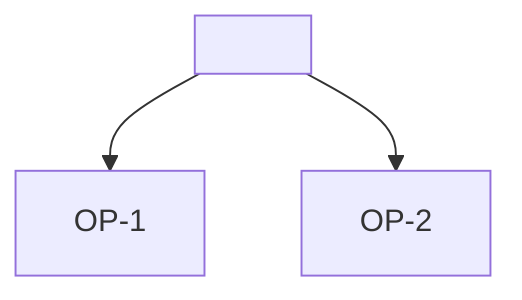

# Opportunities: <title>

## Opportunities

- OP-1 <opportunity> C-1, INT-1
- OP-2 <opportunity nobody has evidence for yet> [assumption: value]

## Solutions

- S-1 <solution idea> for OP-1

## Tree

