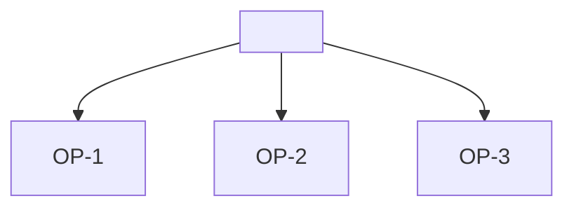

# Opportunities: <title>

## Opportunities

- OP-1 <opportunity> C-1, INT-1
- OP-2 <opportunity nobody has evidence for yet> [assumption: value]
- OP-3 <opportunity the agent proposed and the user accepted> [assumption: value source agent accepted by user]

## Solutions

- S-1 <solution idea> for OP-1

## Tree

## Ranking

<!-- Best first, top three at least. Levels, never scores. The user decides. -->

- R-1 OP-1 evidence: strong; users: C-1; fit: <how it serves the goal>; effort: small; reason: <why it is first>
- R-2 OP-3 evidence: weak; users: estimate "<where the number of users comes from>"; fit: <how it serves the goal>; effort: medium; reason: <why second>
- R-3 OP-2 evidence: weak; users: INT-1; fit: <how it serves the goal>; effort: large; reason: <why third>

## Rejected proposals

- RP-1 <opportunity the agent proposed> rejected by user: <reason>

## So what

- IN-1 <observation>. evidence: OP-1, C-1; so what: <what it changes in the decision of FRAME.md>
- IN-2 <observation>. evidence: OP-2; so what: <what it changes in the decision of FRAME.md>
- IN-3 <observation>. evidence: OP-3; so what: <what it changes in the decision of FRAME.md>
