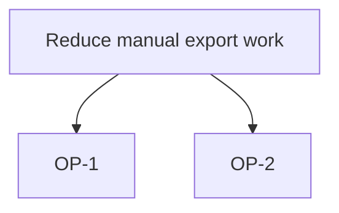

# Discovery format

Templates: [assets/](../assets/). Claims follow [EVIDENCE.md](EVIDENCE.md). Location: `<product.dir>/<slug>/` (config `product.dir`, default `docs/product`). Headings, ids and field keys stay in English; the text is in the user's language.

## 1. Files

| File | Holds | Checker |
|---|---|---|
| `FRAME.md` | problem, whose it is, situation today, out of scope, the decision this discovery supports | `check-research.mjs` |
| `RESEARCH.md` | the search plan, market and context claims each with its source, what was not found | `check-research.mjs` |
| `INTERVIEWS.md` | anonymous synthesis: `INT-n`, themes, exact quotes | `check-research.mjs`, `check-quotes.mjs` |
| `COMPETITORS.md` | the comparison table, one profile per competitor, implications for us | `check-competitors.mjs`, `check-research.mjs` |
| `OPPORTUNITIES.md` | `OP-n` opportunities, `S-n` solutions, a Mermaid tree, a reasoned ranking | `check-opportunities.mjs` |

Each of `RESEARCH.md`, `INTERVIEWS.md`, `COMPETITORS.md` and `OPPORTUNITIES.md` ends with `## So what` ([section 7](#7-so-what)); `check-insights.mjs` checks the set. Every file may hold `## Rejected proposals` ([EVIDENCE.md](EVIDENCE.md#1a-proposals)). Before a document is shown, the author runs the [quality bar](QUALITY-BAR.md); [EXAMPLES.md](EXAMPLES.md) shows a shallow and a good version of each.

The assess files (`ASSUMPTIONS.md`, `PROBES.md`, ...) belong to `product-assess`.

## 2. Ids

Written at line start as `- <ID> <text> <marker>`, unique per slug, never renumbered once cited.

- `C-n`: a claim (FRAME, RESEARCH, COMPETITORS, INTERVIEWS). It carries one marker. A PRD cites it as `[fact: ref <slug>#C-n]`; that is valid only while the line is a valid fact.
- `INT-n`: an interview. The raw text lives only in `.agents/local/product-discovery/<slug>/interviews/INT-n.txt` (personal data, never in git).
- `OP-n`: an opportunity. `S-n`: a solution idea, naming the `OP-n` it answers.
- `AS-n`: an assumption (written later by `product-assess`).

## 3. Claims and numbers

A claim with a number, a percent, an amount of money or a market size is a valid sourced fact (`web`, `interview`, `data` or `ref`), or an assumption marked as an estimate with a basis (`[assumption: value estimate "<basis>"]`, or a range and why that range), or `check-research.mjs` rejects it as `unsourced-number`. A number with no source is never a fact. For a web or interview fact each number of the claim text also occurs in the quote (`number-not-in-quote`). Ids and dates are not numbers. A persona line is a fact, never an assumption (`persona-without-source`).

```markdown
- C-1 Finance copies 400 rows a month by hand. [fact: interview INT-1 "I copy around 400 rows every month"]
- C-2 Several teams export orders to a spreadsheet. [assumption: value]
```

## 3a. Research method (`RESEARCH.md`)

Method text: [RESEARCH-METHOD.md](RESEARCH-METHOD.md). The file has this shape; `check-research.mjs` checks it.

````markdown
## Search plan

- SQ-1 What do small-shop order tools charge per seat?; queries: "order management pricing" | "per seat order tool"; sources: pricing, reviews

## Claims

- C-10 (SQ-1) (critical; second source: C-11) Tool A charges 12 USD per seat. [fact: web https://a.example/pricing accessed 2026-10-01 "12 USD per seat"]
- C-11 (SQ-1) A review quotes 12 USD per seat for Tool A. [fact: web https://reviews.example/a accessed 2026-10-02 "we pay 12 USD per seat"]

## Searched, not found

- SQ-2 No public figure for how many shops export orders by hand.
````

- `SQ-n` lines are written before the first search: the question, the `queries:` and the `sources:` types (`official-docs`, `pricing`, `changelog`, `regulation`, `reviews`, `forums`, `jobs`, `interviews`, `data`).
- Every `SQ-n` is answered by a claim that names it (`(SQ-n)` in the text) or listed under `## Searched, not found` (`query-unanswered`). `- none` is a valid list only when every question has a claim.
- A claim the decision rests on is tagged `(critical; second source: C-m)`; `C-m` is another valid fact from an independent source (another site, interview or data set; the same host is `not-independent`).
- A web fact older than `product.stale_days` is reported `stale`; refresh it or say in the text why the old page still holds. Prefer a page that shows its own date.

## 4. Interviews

`INTERVIEWS.md` lists each interview as `INT-n` (role and date only, no name or contact data) and its claims as `- C-n <paraphrase> [fact: interview INT-n "<quote>"]`. `check-quotes.mjs` finds each quote, whitespace-normalised, in the raw text of the interview it cites; `...` may shorten a quote. A missing raw text is `unverifiable` (exit 1). `--privacy` fails when a raw text is tracked by git or not ignored.

## 5. Competitor table

One table row is one cell of the comparison:

```markdown
| Competitor | Attribute | Value | Source | Observed | Quote |
|---|---|---|---|---|---|
| Acme | Price | 10 USD per month | https://acme.example/pricing | 2026-10-01 | "From 10 USD per month" |
| Acme | Export formats | | | | |
```

The value, source URL, observed date (`YYYY-MM-DD`) and a quoted passage belong together. A value without all of them is `unverifiable-value`: leave it empty and the gap is honest. A cell observed more than `product.stale_days` days before today is reported as `stale` (in text and in `--json`) and does not change the exit code.

The table compares features; it does not say who wins. Each competitor of the table also has a profile and the file ends with what follows for us:

````markdown
## Profiles

### Acme
- sells to: shops with up to ten staff | https://acme.example/customers | 2026-10-01 | "built for teams of up to ten"
- positioning: "orders without a spreadsheet" | https://acme.example | 2026-10-01 | "orders without a spreadsheet"
- pricing model: per seat | https://acme.example/pricing | 2026-10-01 | "per seat, billed monthly"
- praised: fast setup | https://reviews.example/acme | 2026-10-02 | "set up in an afternoon"
- complained: export is manual | https://reviews.example/acme | 2026-10-02 | "I still export to CSV by hand"
- switching cost: unknown

## Implications for us

- Acme's reviewers complain about the manual export we plan to remove, so export is the gap to name against Acme.
````

A value is `unknown`, or `<summary> | <URL> | <YYYY-MM-DD> | "<quote>"` (numbers of the summary occur in the quote), or, for `sells to`, `pricing model` and `switching cost`, a summary with an `[assumption: <risk>]` marker. `positioning` is the competitor's own words and `praised` / `complained` are users' reviews: those three are sourced or `unknown`. Rules: `no-profile`, `profile-field`, `unverifiable-profile`, `no-implications`, `implication-without-competitor`.

## 6. Opportunities

````markdown
- OP-1 Finance cannot export one month in one step. C-1, INT-1
- OP-2 A weekly summary may replace the manual export. [assumption: value]
- S-1 One-click CSV export for OP-1.


````

Every `OP-n` links a `C-n` or `INT-n` that exists, or an `AS-n`, or carries an assumption marker. The Mermaid block lists every `OP-n`. An opportunity the agent proposed and the user accepted is `[assumption: value source agent accepted by user]`.

**Ranking.** No scores, but a reasoned order, best first. The top three (all, when there are fewer) get a line each; the decision stays the user's.

```markdown
## Ranking

- R-1 OP-1 evidence: strong; users: C-1; fit: removes the copying the frame names; effort: small; reason: two sources agree and one page changes
- R-2 OP-2 evidence: weak; users: estimate "about a third of shops, from one interview and a guess at the rest"; fit: indirect; effort: medium; reason: nobody has asked for it yet
```

`evidence` is `strong`, `medium` or `weak`; `effort` is `small`, `medium` or `large`. `users` names a `C-n` or `INT-n` that exists, or `estimate "<basis>"`. A number or a weighted sum is `ranking-level`. Rules: `ranking-missing`, `ranking-size`, `ranking-field`, `ranking-level`, `ranking-users`, `ranking-duplicate`.

## 7. So what

Findings that change nothing are noise. Each of `RESEARCH.md`, `INTERVIEWS.md`, `COMPETITORS.md` and `OPPORTUNITIES.md` ends with 3 to 7 insights:

```markdown
## So what

- IN-1 Two sources put Acme at 12 USD per seat and a review says export is manual. evidence: C-10, C-11; so what: export is the gap to name, so the first release is the export and the price comparison waits.
```

An insight has an observation, the ids it rests on (`evidence: C-n, INT-n, OP-n, AS-n`, each must exist) and `so what:` (at least four words: what changes in the decision named in `FRAME.md`). `check-insights.mjs` rejects a set with no insights (`no-insights`), fewer than 3 or more than 7 in a document, an insight without evidence ids (`insight-without-evidence`) or without an implication (`insight-without-implication`).

## 8. Proposals

The agent proposes: competitors to examine, opportunities, edge cases, alternative solutions, questions nobody asked ([EVIDENCE.md](EVIDENCE.md#1a-proposals)). The user answers each. An accepted proposal is written with `source agent accepted by user`; a rejected one is recorded as `- RP-<n> <proposal> rejected by user: <reason>` under `## Rejected proposals`; a `[proposal: ...]` marker never stays in a finished file (`pending-proposal`).
