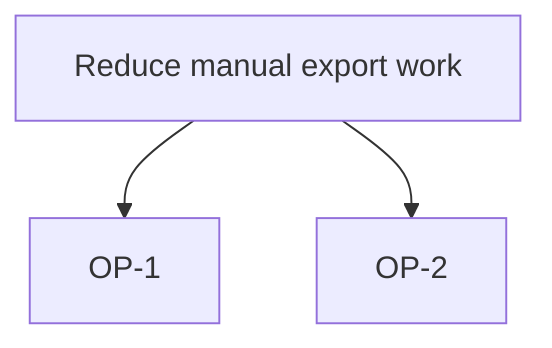

# Discovery format

Templates: [assets/](../assets/). Claims follow [EVIDENCE.md](EVIDENCE.md). Location: `<product.dir>/<slug>/` (config `product.dir`, default `docs/product`). Headings, ids and field keys stay in English; the text is in the user's language.

## 1. Files

| File | Holds | Checker |
|---|---|---|
| `FRAME.md` | problem, whose it is, situation today, out of scope, the decision this discovery supports | `check-research.mjs` |
| `RESEARCH.md` | market and context claims, each with its source | `check-research.mjs` |
| `INTERVIEWS.md` | anonymous synthesis: `INT-n`, themes, exact quotes | `check-research.mjs`, `check-quotes.mjs` |
| `COMPETITORS.md` | the comparison table, one row per cell | `check-competitors.mjs`, `check-research.mjs` |
| `OPPORTUNITIES.md` | `OP-n` opportunities, `S-n` solutions, a Mermaid tree | `check-opportunities.mjs` |

The assess files (`ASSUMPTIONS.md`, `PROBES.md`, ...) belong to `product-assess`.

## 2. Ids

Written at line start as `- <ID> <text> <marker>`, unique per slug, never renumbered once cited.

- `C-n`: a claim (FRAME, RESEARCH, COMPETITORS, INTERVIEWS). It carries one marker. A PRD cites it as `[fact: ref <slug>#C-n]`; that is valid only while the line is a valid fact.
- `INT-n`: an interview. The raw text lives only in `.agents/local/product-discovery/<slug>/interviews/INT-n.txt` (personal data, never in git).
- `OP-n`: an opportunity. `S-n`: a solution idea, naming the `OP-n` it answers.
- `AS-n`: an assumption (written later by `product-assess`).

## 3. Claims and numbers

A claim with a number, a percent, an amount of money or a market size is a valid sourced fact (`web`, `interview`, `data` or `ref`) or `check-research.mjs` rejects it as `unsourced-number`. For a web or interview fact each number of the claim text also occurs in the quote (`number-not-in-quote`). Ids and dates are not numbers. A persona line is a fact, never an assumption (`persona-without-source`).

```markdown
- C-1 Finance copies 400 rows a month by hand. [fact: interview INT-1 "I copy around 400 rows every month"]
- C-2 Several teams export orders to a spreadsheet. [assumption: value]
```

## 4. Interviews

`INTERVIEWS.md` lists each interview as `INT-n` (role and date only, no name or contact data) and its claims as `- C-n <paraphrase> [fact: interview INT-n "<quote>"]`. `check-quotes.mjs` finds each quote, whitespace-normalised, in the raw text of the interview it cites; `...` may shorten a quote. A missing raw text is `unverifiable` (exit 1). `--privacy` fails when a raw text is tracked by git or not ignored.

## 5. Competitor table

One table row is one cell of the comparison:

```markdown
| Competitor | Attribute | Value | Source | Observed | Quote |
|---|---|---|---|---|---|
| Acme | Price | 10 USD per month | https://acme.example/pricing | 2026-10-01 | "From 10 USD per month" |
| Acme | Export formats | | | | |
```

The value, source URL, observed date (`YYYY-MM-DD`) and a quoted passage belong together. A value without all of them is `unverifiable-value`: leave it empty and the gap is honest. A cell observed more than `product.stale_days` days before today is reported as `stale` (in text and in `--json`) and does not change the exit code.

## 6. Opportunities

````markdown
- OP-1 Finance cannot export one month in one step. C-1, INT-1
- OP-2 A weekly summary may replace the manual export. [assumption: value]
- S-1 One-click CSV export for OP-1.


````

Every `OP-n` links a `C-n` or `INT-n` that exists, or an `AS-n`, or carries an assumption marker. The Mermaid block lists every `OP-n`. No scores: ordering comes from the evidence and from `product-assess`.
